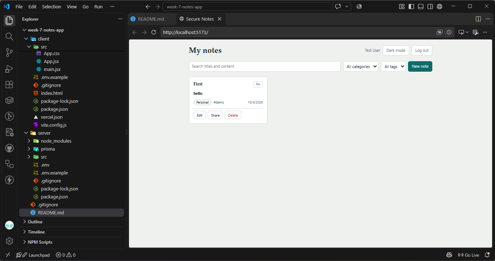

# Week 8 Day 4 Assignment

Refactoring a messy Express server and adding TypeScript types.

## Files

| File                            | Purpose                                         |
| ------------------------------- | ----------------------------------------------- |
| `messy-server.js`               | Original messy code (unchanged, for comparison) |
| `refactored-server.js`          | Task 1: cleaned-up server                       |
| `src/types.ts`                  | Task 2: 5 interfaces                            |
| `src/routes/products.ts`        | Task 2: 3 typed endpoints                       |
| `src/index.ts`                  | App entry that mounts the typed router          |
| `.eslintrc.json`, `.prettierrc` | Bonus: lint and format config                   |

## Scripts

```bash
npm install
npm start          # refactored-server.js on PORT (default 3000)
npm run start:messy
npm run dev        # TypeScript server via ts-node (default 3001)
npm run build      # compile to dist/
npm run typecheck  # tsc --noEmit
npm run lint       # eslint . --ext .js,.ts
npm run format     # prettier --write .
```

## Refactored API (`/api/items`)

- `GET /api/items?category=&min=&max=`
- `GET /api/items/:id`
- `POST /api/items` (name, price required; 201 on success)
- `PUT /api/items/:id`
- `DELETE /api/items/:id`
- `GET /api/stats`

All responses are `{ success: true, data }` or `{ success: false, error }`.

## TypeScript API (`/api/products`)

`GET /`, `POST /`, `GET /:id`.

## Task 3

# Secure Notes

A full-stack personal notes app. Users register, log in, and manage notes that no one else can see.



**Live app:** Local development only
**Live API:** Local development only

## Tech stack

- **Backend:** Node.js, Express, Prisma ORM, PostgreSQL (Supabase or Neon)
- **Frontend:** React (Vite), Axios, react-markdown
- **Auth and security:** bcryptjs, jsonwebtoken, Passport.js (Google OAuth 2.0), helmet, express-rate-limit, cors, zod
- **Deployment:** Vercel (frontend), Render or Railway (backend)

## Features

**Core**

- Register, log in, and log out with a 24-hour JWT
- Sign in with Google (optional). Google users have no password.
- Create, read, update, and delete your own notes; no one else can see them
- Pin notes: pinned notes always appear first
- Categories and search: filter by category, and search titles and content (case-insensitive)

**Bonus**

- [Markdown support](#markdown-support)
- [Tags](#tags)
- [Public sharing](#public-sharing)
- [Dark mode](#dark-mode)

**Admin**

- Users with the `ADMIN` role can read aggregate counts at `GET /api/admin/stats`. Admins never see anyone's note content.

### Markdown support

Note content is written in Markdown and rendered as formatted text on the note card and on shared pages. In the note editor, switch between **Write** and **Preview** to check how it will look before saving.

| You type | You get |
| --- | --- |
| `## Heading` | A heading |
| `**bold**` and `*italic*` | **bold** and *italic* |
| `- item` or `1. item` | Bulleted or numbered list |
| `[Prisma docs](https://www.prisma.io/docs)` | A link (opens in a new tab) |
| `` `code` `` | Inline code |
| Three backticks on their own line, before and after a block | A code block |
| `> quote` | An indented quote |

The renderer follows standard Markdown (CommonMark), so tables, strikethrough, and task lists are not supported. Raw HTML is never rendered and `javascript:` links are stripped, so a note cannot run scripts.

### Tags

Tags are short labels you can attach to a note, in addition to its category.

- **Add:** in the note editor, type a tag in the Tags field and press **Enter** or **comma**. A leading `#` is ignored.
- **Remove:** click the **×** on a tag chip, or press **Backspace** in an empty tag field.
- **Autocomplete:** as you type, the field suggests tags you have already used on other notes.
- **Rules:** tags are saved in lowercase, duplicates are merged, each tag can be up to 30 characters, and a note can have up to 10.
- **Filter:** click a `#tag` badge on any note card, or choose a tag from the **All tags** dropdown in the toolbar. Tag filters combine with search and the category filter.
- **API:** `GET /api/notes?tag=javascript` filters notes, and `GET /api/tags` lists the tags on your notes.

### Public sharing

Every note is private by default. You can share a single note through a public link.

1. On a note card, select **Share**. A banner appears with a **Copy link** button.
2. The link looks like `https://localhost:5173/shared/<long-random-id>`. Anyone with it can read the note without logging in.
3. The shared page shows only the title, content (rendered as Markdown), category, tags, and last-updated date. It never shows your name, email, or account details.
4. Select **Stop sharing** to make the note private again. The link then shows "This note is private or no longer shared."
5. Sharing the same note again creates a **new** link, so a link you shared earlier stays dead.

The link ID is a random UUID, so it can't be guessed from the note's number. API: `PATCH /api/notes/:id/share` toggles sharing (owner only), and `GET /api/public/notes/:shareId` reads a shared note without authentication.

### Dark mode

Use the **Dark mode** button in the dashboard header to switch themes. The choice is saved in your browser's `localStorage` (key `darkMode`), so it persists across page reloads and logins on that device. The saved theme is applied before the page first paints, so there is no flash of the light theme, and shared note pages follow the same setting. It is a per-browser preference and is not stored in your account.

## Setup

Requires Node 18+ and a PostgreSQL database.

### Backend

```bash
cd server
cp .env.example .env     # then fill it in
npm install
npx prisma migrate dev --name init
npm run dev              # http://localhost:4000
```

Generate `JWT_SECRET` with:

```bash
node -e "console.log(require('crypto').randomBytes(32).toString('hex'))"
```

The server refuses to start if `JWT_SECRET` is missing or shorter than 32 characters.

> Supabase: use the direct connection (port 5432) for migrations. For the running app, the pooled string (port 6543) needs `?pgbouncer=true`.

### Frontend

```bash
cd client
npm install
npm run dev              # http://localhost:5173
```

### Google sign-in (optional)

Without these variables the app works normally and the "Continue with Google" button is hidden.

1. Open [Google Cloud Console](https://console.cloud.google.com/apis/credentials) and create or choose a project.
2. Configure the **OAuth consent screen** (External). While it is in "Testing", add your own Google account under **Test users**, or sign-in will be refused.
3. **Credentials > Create credentials > OAuth client ID > Web application.**
   - Authorized redirect URI (local): `http://localhost:4000/api/auth/google/callback`
   - Authorized redirect URI (production): `https://YOUR-API.onrender.com/api/auth/google/callback`
4. Put the values in `server/.env`:

```
GOOGLE_CLIENT_ID="...apps.googleusercontent.com"
GOOGLE_CLIENT_SECRET="..."
GOOGLE_CALLBACK_URL="http://localhost:4000/api/auth/google/callback"
```

The callback URL must match the console entry exactly (scheme, host, port, path). Restart the server after editing `.env`.

How it works: the button sends the browser to `/api/auth/google`, Google authenticates the user and returns to `/api/auth/google/callback`, and the server creates or finds the user and redirects to the client at `/auth/callback#token=...`. The client saves the token like a normal login and removes it from the address bar.

If someone already registered with the same email and a password, Google sign-in is refused with a message to log in with the password. Merging automatically would let a person who pre-registered someone else's email keep access to their account, because this app does not verify emails.

### Making an admin

Registration always creates a `USER`. Run `npx prisma studio` in `server/` and change a user's `role` to `ADMIN`.

## API documentation

All note, category, and tag endpoints need the header `Authorization: Bearer <token>`.

| Method | Endpoint | Description | Auth |
| --- | --- | --- | --- |
| POST | `/api/auth/register` | Create account, returns `{ token, user }` | No |
| POST | `/api/auth/login` | Log in, returns `{ token, user }` | No |
| GET | `/api/auth/me` | Current user | Yes |
| GET | `/api/auth/providers` | Which sign-in providers are enabled | No |
| GET | `/api/auth/google` | Start Google sign-in (browser redirect) | No |
| GET | `/api/auth/google/callback` | Google redirects here, then back to the client | No |
| GET | `/api/notes` | List own notes. Query: `search`, `category`, `tag`, `sortBy`, `order` | Yes |
| POST | `/api/notes` | Create note (`title`, `content`, `category` required; `tags` optional) | Yes |
| GET | `/api/notes/:id` | Get a note | Owner |
| PUT | `/api/notes/:id` | Update a note | Owner |
| DELETE | `/api/notes/:id` | Delete a note | Owner |
| PATCH | `/api/notes/:id/pin` | Toggle pin | Owner |
| PATCH | `/api/notes/:id/share` | Toggle public link | Owner |
| GET | `/api/categories` | Preset categories plus your own | Yes |
| GET | `/api/tags` | Tags on your notes | Yes |
| GET | `/api/public/notes/:shareId` | Read a shared note | No |
| GET | `/api/admin/stats` | User and note counts | Admin |
| GET | `/api/health` | Health check | No |

Error codes: `400` validation, `401` missing or invalid token, `403` not your note (or not an admin), `404` not found, `409` email already registered, `429` rate limited.

## Security

Implemented:

- Passwords hashed with bcrypt (12 rounds); never stored in plain text or returned
- JWT expires in 24 hours; algorithm pinned to HS256; secret read from the environment
- Every note endpoint requires authentication and an ownership check
- Zod validation on request bodies and query strings
- Helmet security headers; CORS limited to `CLIENT_URL`
- Rate limiting: 300 requests per 15 minutes overall, and 10 failed attempts per 15 minutes on login and register
- JSON bodies capped at 10kb; `.env` is git-ignored
- Rate limiter runs **after** CORS, so blocked requests still return CORS headers and the browser shows "too many requests" instead of a CORS error
- Unknown emails and wrong passwords take the same time (a dummy bcrypt comparison runs, the `DUMMY_HASH`) and return the same message
- Markdown is rendered by `react-markdown`, which does not render raw HTML and strips `javascript:` links
- Public share links expose only title, content, category, tags, and date; turning sharing on issues a new link, so older links stay dead

## Testing

### Manual checklist

1. Register a user and land on the dashboard.
2. Create three notes in different categories, one with Markdown (`**bold**`, a list, a link).
3. Pin one. It moves to the top.
4. Search by a title word, then by a content word.
5. Filter by category, then click a `#tag` to filter by tag.
6. Edit a note, then delete a note.
7. Refresh the page: you stay logged in. Log out and in again: notes are still there.
8. Register a second user. They see none of the first user's notes.
9. Request the first user's note by ID with the second user's token. Expect `403`.
10. Click "Continue with Google" (if configured). A new Google user lands on an empty dashboard and cannot log in with a password.
11. Share a note, open the link in a private window, stop sharing, reload. Expect "private or no longer shared".
12. Toggle dark mode and refresh. The theme stays.

### curl (bash)

```bash
# Register and save the token
TOKEN=$(curl -s -X POST http://localhost:4000/api/auth/register \
  -H "Content-Type: application/json" \
  -d '{"email":"test@mail.com","password":"testPass123","name":"Test User"}' \
  | grep -o '"token":"[^"]*"' | cut -d'"' -f4)

# Create a note
curl -X POST http://localhost:4000/api/notes \
  -H "Content-Type: application/json" -H "Authorization: Bearer $TOKEN" \
  -d '{"title":"First","content":"**hello**","category":"Personal","tags":["demo"]}'

# List, search, filter
curl http://localhost:4000/api/notes -H "Authorization: Bearer $TOKEN"
curl "http://localhost:4000/api/notes?search=first" -H "Authorization: Bearer $TOKEN"
curl "http://localhost:4000/api/notes?category=Personal&tag=demo" -H "Authorization: Bearer $TOKEN"
```

On Windows PowerShell use `curl.exe`, and put JSON bodies in a file (`-d "@body.json"`) to avoid quoting problems. If you registered the email already, use `/api/auth/login` instead.

## Author

**Brian Mose**
### 🌐 Socials

<p align="left">
  <a href="https://github.com/tsushumi" target="_blank" rel="noreferrer">
    
  </a>
</p>
<p align="left">
  <a href="https://www.linkedin.com/in/brian-mose-b536a232a" target="_blank" rel="noreferrer">
    
  </a>
</p>
